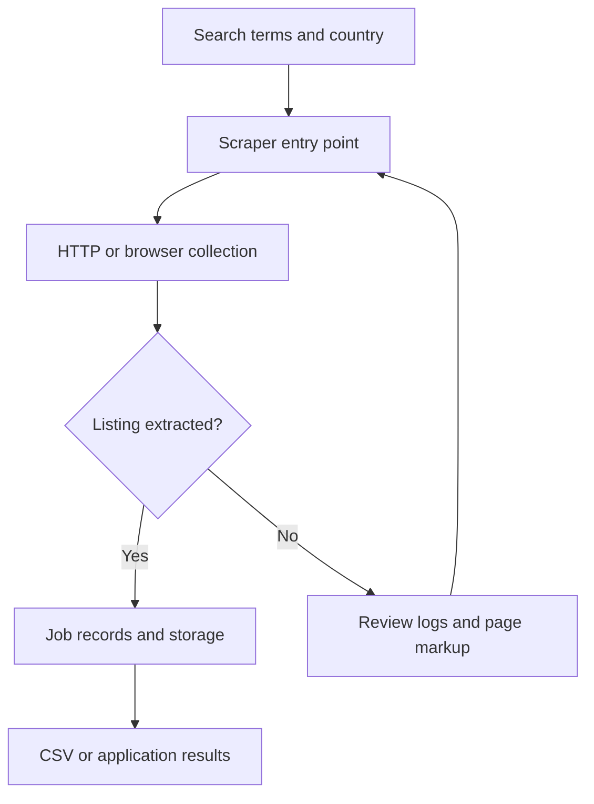

# Indeed Job Scraper — Django

Django job-scraping application with search forms, browser-assisted extraction, database storage, and CSV downloads.

## Project focus

Django application. The sections below separate the runnable entry point, source layout, prerequisites, and verification path.

## Architecture



## Repository structure

| Path | Purpose |
| --- | --- |
| [`indeed_job_scraper/`](indeed_job_scraper) | Project-specific source, resources, or learning material. |
| [`requirements.txt`](requirements.txt) | Python dependency manifest. |

## Getting started

```bash
git clone https://github.com/Raimal-Raja/IndeedScraper_Using_Django.git
cd IndeedScraper_Using_Django
```

```bash
python -m venv .venv
source .venv/bin/activate
```

On Windows PowerShell, activate the environment with `.venv\Scripts\Activate.ps1` instead.

```bash
python -m pip install -r requirements.txt
```

```bash
cd indeed_job_scraper
python manage.py migrate
python manage.py runserver
```

Use the local development server for inspection. Review the project settings before deployment.

## Configuration and scope

Live collection depends on browser availability, the current page markup, site access permissions, and the configured search inputs. Access-control or anti-bot handling is not a guarantee of collection. Inspect saved records for missing fields and duplicates.

## Verification

Use the setup commands and inspect the selected interface, example, or notebook with known inputs. This documentation review checks repository paths and dependency declarations; it does not claim fresh end-to-end execution or model-quality measurements.

## Contributing

Include reproduction steps, the affected path, expected behavior, and the checks you ran. Keep credentials, generated environments, and unnecessary build artifacts out of commits.

## License

No top-level license file is currently tracked. Check reuse permissions with the repository owner.
